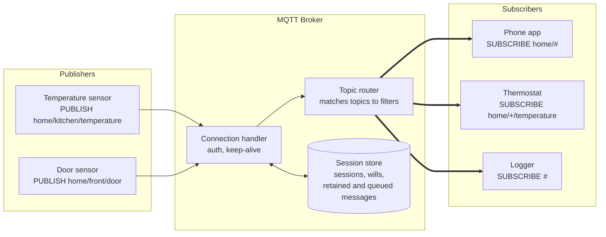
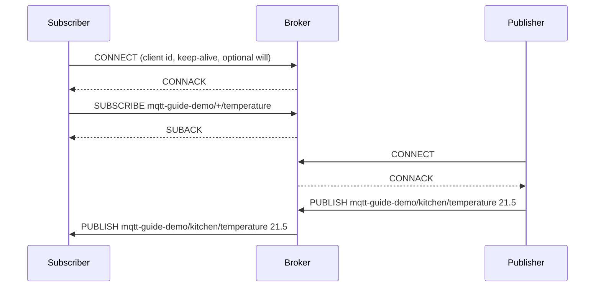
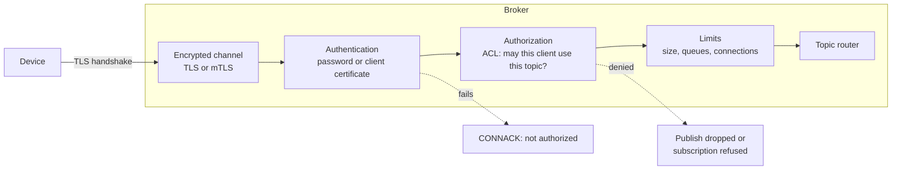

# MQTT for Beginners: How Tiny Devices Talk Through a Broker

Picture a soil-moisture sensor in a field. It runs on a coin battery, its cellular signal comes and goes, and it has maybe a few kilobytes of RAM to spare. It needs to report a number every few minutes, and a farmer's phone, a dashboard and an irrigation controller all want that number.

HTTP is a poor fit here. Each request carries hundreds of bytes of headers, the sensor would need to know the address of every system that cares about its data, and every one of those systems would have to keep asking "anything new?"

MQTT was designed for exactly this situation. This post walks through how it works, one idea at a time, with animations for the parts that are easier to see than to read.

> **Animations:** this post links to three interactive pages in the [`animations/`](animations/) folder. Each is a single HTML file with no dependencies, so you can double-click it to open it in your browser. See [How to view the animations](#how-to-view-the-animations) at the end for other options.

---

## What MQTT is, and why it exists

MQTT is a lightweight messaging protocol built on the **publish/subscribe** pattern. Andy Stanford-Clark (IBM) and Arlen Nipper created it in 1999 to monitor oil pipelines over expensive, unreliable satellite links. Those constraints shaped everything about it:

- **Small on the wire.** The fixed header of an MQTT packet can be as small as 2 bytes.
- **Built for flaky networks.** It has delivery guarantees you can choose per message, and it can detect clients that disappear.
- **Simple for devices.** A client only needs to know one address, the broker's. It never needs to know who else is listening.

Today MQTT is an open OASIS standard. Version 3.1.1 (2014) is still everywhere, and version 5 (2019) adds features such as reason codes, message expiry and user properties. It normally runs over TCP on port **1883**, or **8883** with TLS. It also runs over WebSockets, which is how browsers speak it.

You will find it in smart homes, factory sensors, connected cars, Facebook Messenger's early mobile app, and most cloud IoT platforms.

---

## The big picture

Here is the whole system on one page. Devices that send data are **publishers**, devices that want data are **subscribers**, and the **broker** sits in the middle, routing messages by topic.



Thin arrows are messages arriving at the broker; thick arrows are copies the router sends out to every subscriber whose filter matches. Each subscriber registered its filter earlier with a `SUBSCRIBE` packet.

Notice what is missing: there is no line from any sensor to any subscriber. Publishers and subscribers never talk to each other directly, and they do not need to be online at the same time. The broker handles all of that.

---

## The four building blocks

### Clients

A **client** is anything that connects to the broker: a microcontroller, a phone app, a Python script, a server. Every client identifies itself with a **client ID**, and any client can publish, subscribe, or both. "Publisher" and "subscriber" are roles a client plays, not different kinds of software.

### The broker

The **broker** is the server. Think of it as a post office sorting room. Letters (messages) come in labelled with an address (a topic), and the sorting room drops a copy into the mailbox of everyone who has asked for mail to that address. The sender never learns who the recipients were.

The broker also handles authentication, access control, and remembering things for clients that are offline. Popular brokers include Eclipse Mosquitto, EMQX, HiveMQ and VerneMQ, and most cloud providers offer a managed one.

### Topics

A **topic** is a plain UTF-8 string that labels a message, with levels separated by slashes:

```text
home/kitchen/temperature
factory/line-3/press-7/vibration
```

You do not create topics in advance. A topic exists the moment someone publishes to it. Topics are case-sensitive, so `Home/Kitchen` and `home/kitchen` are different.

### Subscriptions

A **subscription** is a client telling the broker "send me anything published to topics that match this filter." A filter can be an exact topic or it can contain wildcards, which is where MQTT gets flexible.

---

## Topic structure and wildcards

Wildcards only work in subscriptions. You always publish to one concrete topic.

**`+` (single-level wildcard)** stands in for exactly one level.

**`#` (multi-level wildcard)** matches any number of levels, including zero. It must be the last character in the filter.

| Filter | Matches | Does not match |
|---|---|---|
| `home/kitchen/temperature` | `home/kitchen/temperature` | `home/kitchen/humidity` |
| `home/+/temperature` | `home/kitchen/temperature`, `home/garage/temperature` | `home/garage/door/temperature` (two levels where `+` allows one) |
| `home/kitchen/+` | `home/kitchen/temperature`, `home/kitchen/humidity` | `home/kitchen` (no level for `+` to fill) |
| `home/#` | `home`, `home/kitchen`, `home/garage/door/state` | `office/printer/status` |
| `#` | every topic | topics that start with `$` |

A few rules worth remembering:

- `home/#` matches `home` itself, because `#` can match zero levels.
- `home/kitchen+` and `home/#/door` are invalid. Wildcards must fill a whole level, and `#` must come last.
- Topics starting with `$` (such as `$SYS/broker/clients/connected`) are reserved for broker statistics, and a filter starting with a wildcard will not match them.
- Design topics from general to specific (`site/building/room/sensor`), so wildcards can slice the data the way you need. Avoid a leading slash: `/home/kitchen` creates an empty first level.

> ▶ **Try it:** open [`animations/pubsub.html`](animations/pubsub.html). Publish to a few topics and watch the broker decide, subscriber by subscriber, who gets a copy and why. You can edit the three filters to test your own wildcards, and the log explains every match and miss.

---

## Quality of Service: 0, 1 and 2

Networks drop connections. **QoS** (Quality of Service) is how you tell MQTT how hard to try when that happens. You pick it per message, and it trades reliability for extra packets.

| Level | Promise | Packets per message | Good for |
|---|---|---|---|
| **QoS 0** | At most once | 1: `PUBLISH` | Frequent sensor readings where the next one is seconds away |
| **QoS 1** | At least once | 2: `PUBLISH`, `PUBACK` | Most things, as long as a duplicate is harmless |
| **QoS 2** | Exactly once | 4: `PUBLISH`, `PUBREC`, `PUBREL`, `PUBCOMP` | Billing events, commands that must not run twice |

**QoS 0** is a postcard. You drop it in the box and hope. The sender keeps no copy, so if the connection drops mid-flight, the message is gone.

**QoS 1** is a parcel with a delivery receipt. The sender keeps a copy until it receives a `PUBACK`. If the receipt gets lost, the sender resends the message after reconnecting, and the receiver may get it twice. Your code should handle duplicates gracefully.

**QoS 2** is registered mail with a two-step signature. The receiver remembers the message's packet ID, so a resent copy is recognised and ignored. The second exchange (`PUBREL`/`PUBCOMP`) lets both sides safely forget that ID. It is the most reliable level and also the slowest.

Two details trip people up:

1. **QoS is per hop.** The publisher-to-broker leg and the broker-to-subscriber leg are negotiated separately.
2. **The subscriber's level caps delivery.** If a message is published at QoS 2 but the subscriber subscribed at QoS 0, it receives it at QoS 0.

> ▶ **Try it:** open [`animations/qos.html`](animations/qos.html). Pick a level, tick "Lose a packet", and press Play. The counter shows how many times the receiving app actually got the message: zero for QoS 0, twice for QoS 1, and still exactly once for QoS 2.

---

## Retained messages: the last known value

Normally the broker forwards a message and forgets it. A subscriber who joins a minute later gets nothing until the next publish.

That is awkward for state that changes rarely. If a door sensor only publishes when the door opens or closes, a new dashboard could wait hours to learn whether the door is locked.

Setting the **retain flag** on a message fixes this. The broker stores that message as the last known value for its topic, and sends it immediately to anyone who subscribes later. It is like a sticky note on the topic that says "the current state is: locked."

- The broker keeps **one** retained message per topic. A new retained publish replaces the old one.
- To clear it, publish an empty payload with the retain flag set.
- Use it for state (`on`/`off`, `online`/`offline`, configuration), not for streams of events.

---

## Last Will and Testament: reporting your own disappearance

If a device's battery dies, it cannot tell anyone it is offline. MQTT solves this with a **Last Will and Testament** (LWT).

When a client connects, it can give the broker a will: a topic, a payload, a QoS and a retain flag. The broker holds onto it quietly. If the client later disappears without sending a proper `DISCONNECT` (network failure, crash, or silence beyond its keep-alive window), the broker publishes the will on its behalf.

```text
Will topic:   sensors/42/status
Will payload: offline
Retain:       true
```

How does the broker notice silence? Every client agrees to a **keep-alive** interval when it connects. If the broker hears nothing from the client for 1.5 times that interval, it considers the client gone and publishes the will.

A common pattern pairs the will with retained messages. On connect, the device publishes `online` (retained) to its status topic. Its will is `offline` (also retained) on the same topic. Now anyone can subscribe at any time and see an accurate status.

If the client disconnects cleanly, the broker discards the will, because nothing went wrong.

---

## Persistent sessions: picking up where you left off

When a client connects, it chooses between a **clean session** and a **persistent session**.

- **Clean session** (`Clean Start = 1`): the broker forgets everything about the client when it disconnects. On reconnect it starts fresh and must subscribe again.
- **Persistent session** (`Clean Start = 0`, plus a non-zero Session Expiry Interval in MQTT 5; `Clean Session = 0` in 3.1.1): the broker keeps the client's subscriptions and queues any QoS 1 and QoS 2 messages that arrive while it is offline. When the client reconnects with the **same client ID**, the broker reports "session present" and delivers the backlog.

Think of it as a hotel holding your mail while you travel, versus a hotel that throws away your mail the moment you check out.

Persistent sessions are what make QoS 1 and 2 meaningful across disconnects, since the unacknowledged messages have somewhere to live. QoS 0 messages are not queued for offline clients. And the broker's memory is finite, so in MQTT 5 set a sensible session expiry rather than keeping sessions forever.

> ▶ **Try it:** open [`animations/broker-memory.html`](animations/broker-memory.html). It has one tab for each of the three features above (retained messages, Last Will, persistent sessions), and each tab has a toggle so you can compare both behaviours with the broker's storage visible.

---

## Hands-on: connect, publish, subscribe

Here is the conversation you are about to have with a broker:



### Option 1: the command line

Install [Eclipse Mosquitto](https://mosquitto.org/download/), which includes the `mosquitto_sub` and `mosquitto_pub` tools. The examples use `test.mosquitto.org`, a free public test broker. Anyone can read what you publish there, so never send anything private, and use an unusual topic prefix to avoid collisions.

In one terminal, subscribe (`-v` prints the topic next to each message):

```bash
mosquitto_sub -h test.mosquitto.org -t "mqtt-guide-demo/#" -v
```

In a second terminal, publish:

```bash
mosquitto_pub -h test.mosquitto.org -t "mqtt-guide-demo/kitchen/temperature" -m "21.5" -q 1
```

The first terminal prints `mqtt-guide-demo/kitchen/temperature 21.5`. Now try a retained message, then start a fresh subscriber and watch it arrive instantly:

```bash
mosquitto_pub -h test.mosquitto.org -t "mqtt-guide-demo/front/door" -m "locked" -r
mosquitto_sub -h test.mosquitto.org -t "mqtt-guide-demo/front/door" -v
```

Prefer a private broker? Run `mosquitto` on your own machine and replace `test.mosquitto.org` with `localhost`.

### Option 2: Python

Install the Eclipse Paho client with `pip install paho-mqtt` (these examples use version 2.x).

A subscriber that also registers a Last Will:

```python
import paho.mqtt.client as mqtt

BROKER = "test.mosquitto.org"

def on_connect(client, userdata, flags, reason_code, properties):
    print("Connected:", reason_code)
    client.publish("mqtt-guide-demo/reader/status", "online", qos=1, retain=True)
    # Subscribing inside on_connect means we resubscribe after every reconnect.
    client.subscribe("mqtt-guide-demo/+/temperature", qos=1)

def on_message(client, userdata, msg):
    print(f"{msg.topic} -> {msg.payload.decode()}")

client = mqtt.Client(mqtt.CallbackAPIVersion.VERSION2, client_id="mqtt-guide-reader")
client.will_set("mqtt-guide-demo/reader/status", "offline", qos=1, retain=True)
client.on_connect = on_connect
client.on_message = on_message
client.connect(BROKER, 1883, keepalive=30)
client.loop_forever()
```

A one-shot publisher:

```python
import paho.mqtt.publish as publish

publish.single(
    "mqtt-guide-demo/kitchen/temperature",
    payload="21.5",
    qos=1,
    hostname="test.mosquitto.org",
)
```

Run the subscriber, then the publisher, and the reading appears. Kill the subscriber with Ctrl+C and its will fires: a `mosquitto_sub` watching `mqtt-guide-demo/reader/status` will see `offline`.

---

## Security recommendations

The public test broker above has no security at all: no passwords, no encryption, and anyone can read or write any topic. That is fine for learning and a serious problem anywhere else. On plain port 1883, every packet, including the password in `CONNECT`, crosses the network as readable text. A misconfigured broker also lets a stranger subscribe to `#` and watch everything, or publish fake commands to your devices.

Good MQTT security works in layers, the way a building has a locked front door, a badge reader, and keys to individual rooms. Each message passes through every layer before the router sees it:



The configuration examples use Eclipse Mosquitto 2.x. Other brokers have equivalent settings under different names.

### 1. Authentication with username and password

The `CONNECT` packet has username and password fields, and the broker can refuse any client that does not present valid ones. This is the simplest way to stop anonymous strangers from connecting.

Create a password file (Mosquitto stores salted hashes, never the plain passwords) and turn off anonymous access:

```bash
mosquitto_passwd -c /etc/mosquitto/passwd sensor-42
mosquitto_passwd /etc/mosquitto/passwd dashboard
sudo chown mosquitto:mosquitto /etc/mosquitto/passwd
sudo chmod 0700 /etc/mosquitto/passwd
```

The last two lines matter: Mosquitto 2.1 warns when the password file is not owned by the `mosquitto` user and group, and future versions will refuse to load it. Do the same for the ACL file in section 4.

```text
allow_anonymous false
password_file /etc/mosquitto/passwd
```

Give every device its own username. If one device is stolen, you revoke one credential instead of re-flashing the whole fleet. Never ship firmware with a shared default password.

Passwords alone do not hide anything on the wire. Always combine them with TLS.

### 2. Transport Layer Security (TLS)

TLS encrypts the connection, the same way HTTPS protects a website. It also proves to the client that it is talking to the real broker, because the broker presents a certificate signed by an authority the client trusts. By convention, MQTT over TLS uses port **8883**.

```text
listener 8883
cafile   /etc/mosquitto/certs/ca.crt
certfile /etc/mosquitto/certs/server.crt
keyfile  /etc/mosquitto/certs/server.key
tls_version tlsv1.2
```

`tls_version` sets the minimum version the listener accepts. On the client side, point at the CA certificate so the client can verify the broker:

```bash
mosquitto_pub -h broker.example.com -p 8883 --cafile ca.crt \
  -u sensor-42 -P "your-password" -t "sensors/sensor-42/temp" -m "21.5"
```

In Python, add `client.tls_set(ca_certs="ca.crt")` and `client.username_pw_set("sensor-42", "your-password")` before `connect()`, and connect to port 8883.

Do not "fix" certificate errors with options like `--insecure` or by turning off hostname checks. That removes the protection against someone impersonating your broker. Once TLS is working, close port 1883 or bind it to `localhost` only.

TLS does cost something on small devices: a handshake takes CPU time and a few kilobytes of RAM. Elliptic-curve certificates and TLS session resumption keep that cost down, and most modern Wi-Fi and cellular modules handle it in hardware.

### 3. Mutual Transport Layer Security (mTLS)

With plain TLS, only the broker proves who it is. With **mutual TLS**, each client also presents its own certificate, and the broker rejects any client whose certificate was not signed by your CA. A certificate is much harder to guess or leak than a password, which makes mTLS the usual choice for large device fleets and for cloud IoT platforms.

```text
listener 8883
cafile   /etc/mosquitto/certs/ca.crt
certfile /etc/mosquitto/certs/server.crt
keyfile  /etc/mosquitto/certs/server.key
require_certificate true
use_identity_as_username true
crlfile  /etc/mosquitto/certs/revoked.crl
```

- `require_certificate true` turns on client certificate checks.
- `use_identity_as_username true` uses the certificate's Common Name (for example `sensor-42`) as the username, so the ACL rules in the next section work without separate passwords.
- `crlfile` lists revoked certificates, which is how you lock out a stolen device.

The client adds its certificate and private key:

```bash
mosquitto_sub -h broker.example.com -p 8883 --cafile ca.crt \
  --cert sensor-42.crt --key sensor-42.key -t "sensors/sensor-42/#"
```

In Python: `client.tls_set(ca_certs="ca.crt", certfile="sensor-42.crt", keyfile="sensor-42.key")`.

Protect the private key on the device. Where the hardware offers a secure element or TPM, generate and keep the key there so it can never be copied out.

### 4. Access Control Lists (ACLs)

Authentication answers "who are you?" An **ACL** answers "what are you allowed to do?" Without one, any logged-in client can read and write every topic, so a single compromised sensor could subscribe to `#` or send commands to every other device.

Follow least privilege: each client gets only the topics it needs, and only in the direction it needs (read, write, or both).

```text
acl_file /etc/mosquitto/acl
```

```text
# /etc/mosquitto/acl
# Every device may publish only under its own name (%u = username).
pattern write sensors/%u/#
# Every device may read commands addressed to it.
pattern read commands/%u/#

# The dashboard reads all sensor data and sends commands.
user dashboard
topic read sensors/#
topic write commands/#

# The admin account (local listener only) may do anything,
# including reading broker statistics under $SYS.
user admin
topic readwrite #
topic read $SYS/#
```

With this file, `sensor-42` can publish to `sensors/sensor-42/temp` but not to `sensors/sensor-7/temp`, and it cannot subscribe to `#` at all. Anything not listed is denied, and the broker logs a "Denied PUBLISH" line, which makes misconfigured devices easy to spot. `$SYS/#` needs its own line because `#` never matches topics starting with `$`; keep it readable only by admin and monitoring accounts, since it reveals client counts and broker details.

### 5. Limit message rate and size

Even an authenticated client can hurt the broker: a buggy firmware loop that publishes thousands of messages a second, a 200 MB payload, or a thousand reconnects a minute. Limits keep one bad client from taking everyone else down.

```text
# Reject any packet larger than 64 KB
max_packet_size 65536
# Cap unacknowledged QoS 1/2 messages in flight per client
max_inflight_messages 20
# Cap messages queued for each offline persistent session
max_queued_messages 1000
# Force clients to check in at least every 5 minutes
max_keepalive 300

listener 8883
# Cap simultaneous connections on this listener
max_connections 5000
```

Pick numbers that fit your real traffic: if your largest legitimate payload is 2 KB, a 64 KB limit already leaves plenty of room. MQTT 5 also lets each side announce a Maximum Packet Size and a Receive Maximum during `CONNECT`, so well-behaved clients learn the limits up front.

Mosquitto has no per-client "messages per second" setting. Brokers such as EMQX and HiveMQ offer per-client publish rate limits directly. With Mosquitto, combine the settings above with connection rate limiting at the firewall or load balancer.

### 6. Keep software and firmware updated

Brokers, client libraries and TLS libraries all receive security fixes, and published vulnerabilities in MQTT brokers are scanned for on the internet within days. An unpatched broker undoes everything above.

- Subscribe to the security advisories for your broker and MQTT client library, and update on a schedule rather than "when something breaks."
- Build over-the-air (OTA) firmware updates into devices from day one. Sign firmware images and have devices verify the signature before installing, so the update channel cannot itself become an attack.
- Keep the TLS library on devices current, and plan for certificate expiry and CA rotation; a device that cannot update its trusted CA will eventually stop connecting.
- Remove unused listeners, test accounts and default credentials before going to production.

### Putting it together

A single `mosquitto.conf` covering all of the above for a fleet using mTLS:

```text
# Global settings
allow_anonymous false
# Passwords for the local listener; mTLS clients use their certificate instead
password_file /etc/mosquitto/passwd
acl_file /etc/mosquitto/acl
max_packet_size 65536
max_inflight_messages 20
max_queued_messages 1000
max_keepalive 300

# Local plain-text listener for on-host tools only
listener 1883 127.0.0.1

# Public listener: TLS with client certificates
listener 8883
cafile   /etc/mosquitto/certs/ca.crt
certfile /etc/mosquitto/certs/server.crt
keyfile  /etc/mosquitto/certs/server.key
tls_version tlsv1.2
require_certificate true
use_identity_as_username true
crlfile  /etc/mosquitto/certs/revoked.crl
max_connections 5000
```

Mosquitto treats only lines that start with `#` as comments, so keep comments on their own lines rather than after a setting. Test the file with `mosquitto -c /etc/mosquitto/mosquitto.conf -v` before restarting the service.

---

## When to choose MQTT

**MQTT is a strong choice when:**

- You have many small devices sending small, frequent messages.
- Networks are slow, expensive or unreliable (cellular, satellite, battery-powered radios).
- Several consumers want the same data, and you do not want devices to know about them.
- You need to know when devices go offline (Last Will) or what their current state is (retained messages).
- You want push delivery instead of polling.

**Look elsewhere when:**

- You need request/response with rich semantics, such as a public REST API. HTTP is simpler there. (MQTT 5 can do request/response, but it is not its strength.)
- You need to replay a long history of events or process huge streams. A log-based system like Apache Kafka fits better, and the two are often used together, with MQTT at the edge and Kafka in the data centre.
- You need complex routing, transactions or work queues between back-end services. AMQP brokers such as RabbitMQ offer more there.
- Your "devices" are browsers talking to one server. Plain WebSockets or server-sent events may be enough.

---

## Cheat sheet

| Concept | One-line summary |
|---|---|
| Broker | The server that receives every message and routes it by topic |
| Client | Anything that connects; can publish, subscribe, or both |
| Topic | A slash-separated label like `home/kitchen/temperature` |
| `+` | Wildcard for exactly one topic level |
| `#` | Wildcard for all remaining levels; must be last |
| QoS 0 / 1 / 2 | At most once / at least once / exactly once |
| Retained message | The broker keeps the last value per topic for new subscribers |
| Last Will | A message the broker publishes if a client vanishes uncleanly |
| Keep-alive | The interval a client promises to stay in touch within |
| Persistent session | The broker keeps subscriptions and queues messages while you are offline |
| TLS / mTLS | Encrypts the connection on port 8883; mTLS also checks a certificate from every client |
| ACL | Per-client rules for which topics it may read or write |

---

## How to view the animations

All three animations are self-contained HTML files in [`animations/`](animations/). No installs, no internet connection, no build step.

| Animation | What it shows |
|---|---|
| [`animations/index.html`](animations/index.html) | A menu linking all three |
| [`animations/pubsub.html`](animations/pubsub.html) | Topic routing and wildcard matching, with editable filters |
| [`animations/qos.html`](animations/qos.html) | QoS 0, 1 and 2 handshakes, with optional packet loss |
| [`animations/broker-memory.html`](animations/broker-memory.html) | Retained messages, Last Will, and persistent sessions |

**Easiest:** double-click any of the files, or drag it onto a browser window.

**From a local server** (useful if your Markdown viewer blocks local links), run this from the project folder and open <http://localhost:8000/animations/>:

```bash
python -m http.server 8000
```

GitHub and most Markdown previewers show the HTML source instead of running it, so open the files from a local copy of the project.
